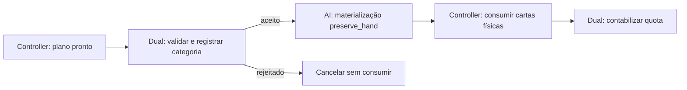

# HAL-22 — diagnóstico de materialização AI HARD MODE × Dual Play (I2)

**I2 foi reproduzido com somente os dois MODs, incluindo uma divergência de contabilização produzida pelo controller e pelo planner oficiais em um host de testes. Não há correção de produção nesta entrega nem comprovação em duelo completo Windows.**

Branch independente: `test/hal-22-ai-hard-mode-dual-play`, derivada de `integration/hal-20-v0.3.1-preview.2` em `d649647c159c91d615c07d6960928a37e270b461`. Núcleo oficial `aceac3782902746f35ddb0148809450933327cb3`, SDK API 24. [PR #15 em rascunho](https://github.com/otavioarns-cyber/Yu-Gi-Oh-Forbidden-Memories-Recompiled/pull/15), direcionado à integração, sem merge. [Tarefa HAL-22](https://linear.app/half-programer/issue/HAL-22).

Leitura de continuidade: `AGENTS.md`, [relatório e matriz do PR #14](https://github.com/otavioarns-cyber/Yu-Gi-Oh-Forbidden-Memories-Recompiled/pull/14), congelados em `ae43436e0e23437642ab45eb4da2b4a9374c2e39`. [INPUTS.json](hal-22/INPUTS.json) registra os hashes dessas evidências e dos insumos atuais. Os achados I1, I3 e F1 não foram incorporados aos testes ou corrigidos.

## Resultado e alcance

| Perfil | Ordem solicitada de carga | Cadeia observada no swap | PASS | FAIL | BLOCKED |
|---|---|---|---:|---:|---:|
| O0 | H → D | Dual → AI; worker nativo não executado com AI ativo | 44 | 0 | 0 |
| O1 | H → D neste recorte de dois MODs | Dual → AI | 44 | 0 | 0 |
| O2 | D → H | AI; gate Dual não executado | 25 | 15 | 4 |
| O0, primeira carga tardia de H | H → D configurado; D já carregado antes da ativação de H | AI; mesma falha de O2 | 25 | 15 | 4 |

Total: **138 PASS, 30 FAIL e 8 BLOCKED**, mais **1 PASS de comparação entre perfis**. Os 30 FAIL são repetições de 15 invariantes nos dois perfis com a mesma cadeia insegura; não representam 30 bugs distintos. Os oito BLOCKED são a limpeza posterior a uma rejeição que não aconteceu porque o gate foi contornado. Limites globais estão separados em `RESULTADOS.json`.

Duas compilações de executáveis **próprios de teste**, quatro execuções do harness e quatro do manager. Nenhum MOD ou objeto da engine foi recompilado. Os 32 itens de preflight e os mesmos 32 de pós-execução passaram. O runner termina com **código 1** para manter as falhas diagnósticas visíveis; não houve execução incompleta. A compilação própria registra warnings de typedefs/asserts de layout e declarações PsyQ já presentes nos headers oficiais; não houve erro de compilação. O log bruto foi preservado, inclusive um espaço de fim de linha emitido pelo compilador.

- [Matriz CSV por cenário/invariante](hal-22/resultados/MATRIZ.csv)
- [Resultados, comandos, observações e limitações](hal-22/resultados/RESULTADOS.json)
- Logs: [O0](hal-22/resultados/O0.log), [O1](hal-22/resultados/O1.log), [O2](hal-22/resultados/O2.log), [carga tardia](hal-22/resultados/O0-late-AI.log)
- [Reprodução e dependências](../tests/hal22/README.md)

## Insumos, preservação e permissão

| Componente local | SHA-256 do objeto | Identificação do loader |
|---|---|---|
| AI HARD MODE oficial 0.1.0, PR #8 | `9171b85bf3f1e99d560c0d4b7820960d1310168036b0437f31bdc4161b41b5bc` | API mínima 4, hash `3e0648cb`, host API 24 |
| Dual Play 0.5.7, recompilação i386 do PR #10 | `77cd32ff89de6ca37084113fcafb933a98a1cfeea52a78a936b24640b11a2378` | API 24, hash `3028c68a`, estado registrado 50 bytes/v10 |

Os manifests locais também foram conferidos por hash. AI usa seus defaults, inclusive `preserve_hand=1`, `deck_access=0`, planejamento e orçamento originais. A ativação dos dois MODs é própria do perfil de testes; não modifica o default `enabled=false` do AI.

Dez objetos nativos da compilação anterior da base foram reutilizados sem alterações. Seus nomes, hashes e fontes oficiais estão em `INPUTS.json`. Somente funções públicas selecionadas são vinculadas; nenhuma função estática privada é invocada por convenção de chamada presumida. A infraestrutura própria de loader/trace/hook do PR #14 foi reaproveitada, removendo as dependências dos outros MODs.

**Não há permissão verificável para redistribuir Dual Play. Seu fonte, manifest e objeto não acompanham esta publicação.** O runner exige cópias locais com o hash conhecido e não as baixa. Publicam-se apenas testes próprios, metadados de identificação e logs de execução. Nenhum objeto compilado, asset, imagem de jogo, save, segredo ou pacote de terceiro foi acrescentado à branch.

## Causa de I2 e responsabilidade dos componentes

Em [`ai_hard_mode.c:271–307`](../mods/ai-hard-mode/ai_hard_mode.c#L271), `swap_selection` delega ao anterior somente se o AI não estiver ativo no contexto ou se `preserve_hand` estiver desligado. Com o default ligado e o contexto válido, o AI realiza sua própria materialização e retorna. Isso vale também quando todas as escolhas já são físicas (11..15): não há troca de registros a fazer, mas o anterior continua sem ser chamado.

O [`hooks.c`](../src/pc/mods/hooks.c) oficial encadeia por registro: o último wrapper registrado é o primeiro executado. Assim:



Esse é o caminho observado em O0/O1. Em O2, o controller entra diretamente no materializador do AI e o wrapper Dual do swap não executa. Os hooks do Dual no controller e na preparação do snapshot continuam ativos: o MOD não está inteiramente desligado.

A inspeção privada do Dual, identificada pelo objeto/fonte do PR #10, explica o efeito adicional: o hook do swap é também o **snapshot autoritativo da categoria do plano CPU**. Antes do planner terminar, o controller pode ter registrado uma categoria provisória a partir do cursor da mão. Sem a atualização no swap, essa categoria pode sobreviver e sobrepor a categoria efetivamente consumida na contabilização.

A divisão correta de responsabilidades permanece:

| Responsável | Contrato que precisa ser preservado |
|---|---|
| AI HARD MODE | Decidir o plano e escolher as substituições de `preserve_hand`, sem assumir quotas privadas do Dual |
| Dual Play | Autorizar Monster/Support/Ritual no bônus e registrar a categoria definitiva antes de qualquer materialização |
| Materializador AI ativo ou materializador nativo no fallback | Executar uma vez a transformação lógica → física, conservando instâncias |
| Controller nativo e wrapper Dual | Consumir a seleção física e contabilizar a categoria do plano executado |

Não é necessário atribuir o problema a Ritual Duelists ou aos MODs de efeitos: eles não são carregados neste harness.

## Aproximação ao controller: o que foi reproduzido sem injetar o plano

O teste executa corpos nativos oficiais de `DuelScene_UpdateHandActions`, `func_80028220`, `func_80027DF8`, `AiScript_Init`, `Ai_GetHandSize`, `func_8001BAF0`, helpers de marcação/seleção e limpeza de slots. Usa loader, hooks e eventos oficiais. A RAM é sintética e conserva aliases importantes: registros do deck a `active−0x31E0`, staging/records compartilhados e os bytes adjacentes `D_8009B360`/`gDuel_bOpponentID`. A tabela pública oficial de oponentes fornece a janela de Rex, 8.

**Nos dois casos abaixo não se escrevem planos, quotas, bônus, `last_plan` ou `used` do Dual.** O teste constrói um estado inicial de mão/campo/deck com catálogo sintético; o planner oficial escolhe; o controller nativo seleciona e remove a carta física. Os callbacks `frame` do Dual compactam a mão restante e concedem o bônus. Só a conclusão gráfica e a ponte simples de resolução de efeito/placement para o campo são modeladas entre ações.

| Entrada construída | Primeira ação, igual em todos os perfis | O0/O1 | O2/carga tardia |
|---|---|---|---|
| Cursor inicial em Monster, campo de Monsters fortes, Support útil disponível | Support ID 344; mão 5 → 4 | `used=Support`; bônus escolhe Monster ID 110; `used=3` | `used=Monster`; bônus escolhe Support ID 343; dois Supports consumidos, `used=1` |
| Cursor inicial em Support, campo vazio, Monster mais vantajoso disponível | Monster ID 35; mão 5 → 4 | `used=Monster`; bônus escolhe Support ID 344; `used=3` | `used=Support`; bônus escolhe Monster ID 110; dois Monsters consumidos, `used=2` |

Em cada ação, o contador registra uma entrada no materializador AI e zero no nativo. Para seleções já físicas, não há troca extra de deck. A segunda ação deixa três cards na mão. A comparação entre perfis confirma as mesmas duas escolhas iniciais sem alterar a estratégia; as escolhas do bônus divergem porque o Dual recebe uma categoria contabilizada diferente.

Excertos de O2:

```text
first-id=344 category=2 hand=4 phase=6 gate=0 worker=1 stock_worker=0
BONUS_SNAPSHOT window=4 used=1 ids=0,343,0,0
second-id=343 category=2 hand=3 phase=6 window=4 mask-ok=1
```

Isso é uma reprodução **mais próxima do controller** que os planos adversariais do PR #14. Demonstra que uma contabilidade errada pode ser gerada pelo código executado no modelo, sem injetar um plano ilegal após o filtro. **Não prova que esse estado inicial seja alcançado pelos decks/catálogo reais de um oponente em uma partida.**

A construção inicial não é uma trajetória completa de turnos anteriores, e a janela pública de Rex não transforma o deck sintético no deck verdadeiro de Rex. A confirmação em gameplay continua **BLOCKED** por falta da imagem/tabelas/runtime de jogo. Não se afirma que já houve exploit numa partida Windows.

## Categoria já gasta, Ritual, cancelamento e materialização

A preparação normal do Dual mascara no snapshot lógico as categorias contabilizadas como usadas e os Rituais do bônus. Isso passou em todos os perfis. A máscara funciona inclusive em O2; o problema é que pode usar uma categoria previamente contabilizada de forma errada.

A janela efetiva do AI no bônus foi **4**, devido ao limite `available()` quando a mão tem menos de cinco cards. Portanto, planos adversariais antigos que pressupunham uma janela de oito cards durante esse bônus **não foram comprovados como naturalmente alcançáveis com os defaults oficiais**.

Quatro testes de barreira usam bônus construído pelos callbacks reais e depois injetam, explicitamente, um snapshot/seleção adversarial: Monster já usado, Support já usado, Ritual e seleção vazia. Em O0/O1, o Dual rejeita todos antes do worker, limpa a seleção e cancela o bônus sem gastar cartas ou quotas. Em O2 e carga tardia, o gate não roda; não há sinalização de rejeição, e sua limpeza fica BLOCKED. Esses quatro planos continuam sendo **injeções de teste**, não decisões atribuídas ao planner.

Outros controles executados:

- A janela nativa de oito cards permite ao planner selecionar um próximo Monster. O AI realiza **uma** troca/respawn, sem chamar o worker nativo; os 80 identificadores de instância são conservados e os índices físicos do deck permanecem estáveis.
- Um plano de duas cópias de ID 35 com identidades distintas, injetado para testar o materializador, produz uma entrada no worker e duas trocas/respawns, em slots distintos. Não certifica fusões ou receitas.
- AI OFF: Dual → worker nativo, uma vez; teste da cadeia de materialização, sem executar estratégia retail.
- Dual OFF: worker AI, uma vez.
- OFF/ON dos MODs já carregados conserva a cadeia anterior via `Hooks_Relink`: preserva tanto a ordem segura como a insegura.
- O hook real de novo duelo limpa quotas/bônus/pending. Não foram usados saves antigos.

## Ordem válida, estabilidade e proposta mínima

**No recorte testado, a inversão da cadeia é a variável causal de I2.** O0/O1 corrigem todas as invariantes examinadas sem mudar os objetos. Não há evidência aqui de outro desvio com Dual → AI. Isso não certifica outras combinações de MODs.

Há, porém, duas ordens diferentes a considerar: a lista resolvida pelo manager e a ordem histórica de registro dos hooks. `Mods_Order` aceita H → D e D → H com os manifests originais. O0/O1 do PR #14 se projetam no mesmo grafo H → D quando os demais MODs são removidos.

Em uma inicialização limpa com H antes de D, o Dual fica externo e a composição é correta. OFF/ON após ambos terem sido carregados não muda essa posição. Mas [`Mods_SetEnabled`](../src/pc/mods/mods.c#L4555) retorna para escolhas já iguais e `activate_once` só carrega a biblioteca ainda não carregada; [`Mods_Apply`](../src/pc/mods/manager.c#L177) não recria os registros existentes. Assim, D já carregado → primeira ativação de H registra H por último. O perfil de carga tardia demonstra o desvio com hooks reais, mesmo quando o teste de ordenação do manager ainda retorna H → D. A janela completa de Apply não foi executada: a ligação com seu ciclo de vida também é uma conclusão estática das rotinas oficiais citadas.

**Menor mitigação verificável, sem patch de produção:** perfil experimental com carga inicial H → D e reinício completo após mudanças na ordem ou primeira ativação de um dos dois. Não confiar só no texto da lista do manager; exigir trace Dual → AI no swap. Isso preserva o AI inteiro e o Dual original, mas é um protocolo restrito de inicialização, não uma correção geral para ativação ao vivo.

**Proposta para eventual implementação autorizada:** assegurar a ordem efetiva no componente de organização de hooks sob nosso controle, mantendo Dual como validador externo e AI como único materializador ativo. O contrato a testar é:

1. Resolver H → D antes de permitir a composição neste perfil.
2. Após carga inicial, primeira carga tardia, OFF/ON ou alteração de ordem, obter Dual → AI → fim no caminho ativo, e Dual → nativo no fallback.
3. Rejeitar a composição insegura ou pedir reinício antes de executar ações caso o core não consiga restabelecer esse grafo com segurança.

Uma alternativa a avaliar separadamente é um modo **opt-in** no organizador/relink que aplique a ordem lógica resolvida aos wrappers, preservando a ordem interna dos registros de cada dono. Isso não muda o Dual nem o algoritmo da IA, mas muda semântica de encadeamento e exige revisão do core/API e regressões de outros hooks. **Não foi implementado, nem demonstrado como um patch trivial já aprovado.** Não se propõe alterar globalmente o contrato atual de ordem de registro sem essa revisão.

Se o perfil puder exigir reinício, há um candidato menor de ciclo de vida: perfil H → D acompanhado de `restart=true` no manifest **próprio** do AI, para impedir sua primeira aplicação tardia. Essa propriedade existe no core, mas a combinação completa ainda exige teste no manager/UI; não foi aplicada. O custo é adiar ON/OFF do AI até reinício, que deve ser decidido explicitamente. `before` não é um campo de ordenação suportado nesta base; o parser atual usa `requires`/`after`, prioridade e ranks salvos. Não se recomenda uma propriedade inexistente nem editar o manifest de terceiro.

**Não há patch local seguro demonstrado em `swap_selection` que apenas acrescente `previous_swap`.** Chamar o anterior antes da escolha própria permite ao materializador nativo executar a política de substituição antes de `preserve_hand`. Chamar depois valida tarde demais, sobre um snapshot anterior a uma troca já feita; uma rejeição não desfaz essa troca. Também é necessário examinar retornos parciais e seleções normalizadas antes de afirmar ausência de segunda materialização. Nenhuma dessas chamadas foi acrescentada.

## Critérios para autorizar uma correção

- Manter hashes/defaults e decisões iniciais do AI; não alterar `deck_access`, `preserve_hand`, dificuldade, quotas, decks ou categoria de cartas.
- Passar os casos de controller, Monster/Support já utilizados, Ritual e cancelamento desta entrega, com gate antes do worker; preservar o snapshot autoritativo para contabilização.
- Exigir exatamente um worker para cada ação aceita, zero para rejeitada, e uma troca por instância lógica que precise ser materializada. Incluir uma/duas/múltiplas escolhas, IDs iguais, seleção física e offscreen, falhas e retornos parciais, fallback inativo e conservação de deck/mão.
- Testar primeira carga de cada MOD, ambos no startup, ambos já carregados OFF/ON, mudança de ranks, novo duelo e estados de transição; verificar Apply real e restart no runtime, não somente sua ordenação isolada.
- Se houver mudança no core, comparar todos os demais encadeamentos e contratos antes de integrar. Não promover a alteração de semântica de hooks com base apenas nestes dois MODs.
- Reproduzir em Windows i386/API 24, com imagem legal local e decks/catálogo reais: capturar a mão, plano, categoria definitiva, consumo, quota e ações do mesmo turno. Não forçar os planos nem editar as opções estratégicas para obter a falha.

Permanecem hipóteses: ocorrência nos decks reais, frequência, caminhos adicionais do interpreter retail, outras janelas/oponentes e estabilidade de uma futura correção no manager completo. Esta entrega autoriza revisar o diagnóstico e selecionar o próximo escopo; não contém autorização implícita nem aplicação de correção funcional.

## Arquivos desta entrega

`tests/hal22/{harness.c,order.c,run.py,README.md}`, este relatório, `notes/hal-22/INPUTS.json`, matriz/resultados/logs e metadados de publicação. `AGENTS.md` recebe somente o novo ponto de continuidade. Nenhum arquivo de produção em `mods/`, `src/`, `config/` ou SDK é alterado. Master, integração e branches anteriores permanecem preservadas ([19 heads conferidos](hal-22/REFS_PRESERVADAS.json)); PR em rascunho, sem merge. [Índice dos arquivos públicos e hashes](hal-22/PUBLICATION_FILES.json), excluindo o próprio índice para evitar hash recursivo.
