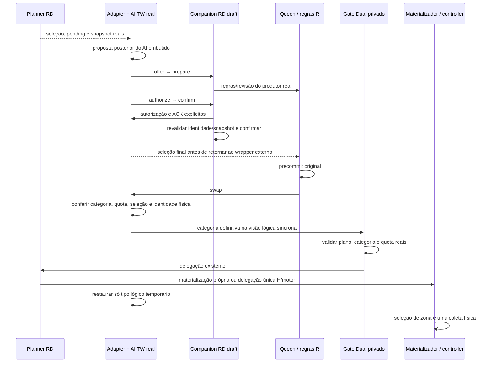

# HAL-9 / HAL-20 — Cliente TW cooperativo e categoria definitiva

[PR #35 em rascunho](https://github.com/otavioarns-cyber/Yu-Gi-Oh-Forbidden-Memories-Recompiled/pull/35). HAL-9/HAL-20 atualizadas no Linear por comentários, sem encerrar tarefas; recibos em [LINEAR_UPDATES.json](hal-9-client/LINEAR_UPDATES.json).

Candidata experimental derivada do PR #34, branch `test/hal-9-tw-client-category`, referência `7855862525222ae6dbecfa02ae607352a41cc675`. PR destinado a `integration/hal-20-v0.3.1-preview.2`. Nenhuma política de gameplay foi escolhida. Time Wizard continua fora do guard.

## Resultado e decisão pendente

O cliente está agora **no adapter próprio realmente vinculado ao objeto TW executado**, em cópia privada. O driver após o planner do PR34 não negocia nos novos casos100–125. O padrão é OBSERVE; KEEP_RD e ALLOW_TW só são configurados explicitamente pelos testes, sem setting novo no manifest. Os fontes/objetos canônicos, ABI1, efeitos, estratégias, probabilidades, recipes, assets, guard e política B permanecem intactos.

KEEP_RD e ALLOW_TW são tecnicamente viáveis na fronteira de uma carta física pré-consumo. KEEP conserva a ação RD; ALLOW exige consentimento e revogação pelo próprio RD apenas do pending correspondente ainda não executado. Queen continua mandatória: KEEP preserva a seleção anterior e ALLOW recebe veto. A **decisão funcional** entre essas políticas continua exclusiva do usuário; o mecanismo não resolve essa decisão por prioridade de hooks.

Os resultados exatos, contagens e classificações estão em [RESULTADOS.json](hal-9-client/RESULTADOS.json), [matrizes/logs por grupo](hal-9-client/primary/MATRIZ.csv) e [oráculos independentes](hal-9-client/CLIENT_INVARIANTS.json). As regressões mantêm o FAIL histórico de reset em voo; não o corrigimos nem o tratamos como gameplay normal.

Resultado final: **352 processos completos**, classificados em144 PASS,196 REFUSED,4 NOT_REACHED e8 FAIL históricos. **3.508 verificações PASS e8 FAIL históricos**. A fronteira nova (208 processos/2.008 verificações) não apresentou FAIL; os8 FAIL estão exclusivamente no caso34 legado da roleta. As quatro condições NOT_REACHED são o probe de gate com Dual OFF, onde não existe quota Dual a exercitar. As regressões finais exigem explicitamente a jogada mandatória de Queen com RD OFF e passam nos8 perfis.

## Implementação e arquivos

- [tw_client.inc](../experiments/hal9-client/tw_client.inc): cliente próprio, validação de pacote/callbacks, ACK, estado efetivamente aplicado e fronteira de categoria/identidade. Incluído somente na cópia privada do adapter.
- [adapter.patch](../experiments/hal9-client/adapter.patch): liga o cliente ao retorno de `compat_ai_run`, ao swap, à escolha de zona, ao hand controller e aos callbacks próprios de reset/applied/shutdown; acrescenta um hook localizado de snapshot. Não modifica o motor/controller global nem os algoritmos do planner.
- [builder e reprodução](../tests/hal9-client/README.md): recompila apenas o adapter e relinka seis unidades privadas fixas. Não é recompilação integral do núcleo0.23.1. `time_wizard_ai.c` avulso continua sem substituir o AI embutido.
- [runtime/faults](../tests/hal9-client/runtime.inc), [oráculos](../tests/hal9-client/verify_logs.py) e [coleta](../tests/hal9-client/collect.py): testes próprios, sem distribuição do Dual/core/recursos privados.
- Três arquivos do harness existente mudam somente para despacho/observação/recibo privado: `tests/hal20-field-state/harness.c`, `run.py` e `tests/hal9-support/support.inc`.

O RD companion do PR34 é reutilizado byte a byte, inclusive o monitor real, o produtor R real e os callbacks de commit. Não se modifica nem se reinterpreta `mandatory-hand-selection-v1`. O companion continua uma draft separada, sem promoção ao SDK/contrato aprovado.

## Sequência realmente executada

Mover a negociação para dentro do adapter importa: o precommit de R é externo ao swap do TW e não poderia ser consertado por uma negociação iniciada somente dentro desse swap. Queen também pode restaurar ID/destino mas deixar bytes de posição diferentes; o companion conserva a seleção anterior completa em KEEP, não apenas o ID.

## Contrato e lifecycle do cliente

A descoberta opcional usa exatamente `ritual-duelists:selection-finalization-v1`, ABI/tamanho/magic e todos os callbacks obrigatórios. O cliente verifica cabeçalhos, limites da seleção, action/generation/connection/nonce/client, snapshot, ticket e cópias integrais nas duas callbacks. A confirmação depende de token, owner efetivo e revalidações reais do produtor; `HfStatus` não é autorização.

O cliente permite seus callbacks apenas durante a etapa síncrona esperada, com tabela descoberta ainda igual, proposta/ticket idênticos e **TW efetivamente aplicado**. `applied(on)` real alimenta esse estado; a preferência salva não o substitui. Preferência OFF com restart pendente conserva o owner ON. OFF efetivo durante negociação impede o ACK/continuação. Reset/shutdown/OFF tentam a desconexão cooperativa; uma recusa BUSY não autoriza esquecer/liberar código ou contexto. A tabela do cliente é estática e o SDK mantém bibliotecas residentes até o encerramento do processo.

Depois que uma oferta real começou, falha de ABI/token/autorize/ACK/identidade não pode cair no caminho independente de consumo caso o RD seja desativado no meio da chamada. O adapter retorna0 antes de o controller avançar e registra recusa local. Antes da coleta, cursor/pilha alterados também congelam a ação pelo adapter, sem limpar pending. O diagnóstico local é `tw_final_block` + `tw_hf_result`; deve ser cruzado com RHS/token/effective, não exibido como autorização. A recuperação dessa recusa local exige o callback efetivo de reset do adapter ou reinício do processo; a limpeza apenas por iniciar outro duelo não foi qualificada nesta entrega; não se acrescentou UI nem `recover()` automático.

Companion ausente/incompatível não concede handoff. Com RD canônico ativo, continua valendo a recusa anterior de seleção divergente pelo monitor. Com RD frio OFF, o TW independente continua exercitado pelas regressões Support. Não se transforma uma dependência opcional numa exigência funcional geral.

Uma seleção vetada pode dar lugar a **novo planejamento com outro action/token e novos callbacks explícitos**: o caso119 distingue isso de retomar silenciosamente o ticket anterior. Nenhum cancelamento restaura carta, reconstitui pending por ID ou desfaz consumo físico.

## Categoria definitiva e quotas

Antes, ID16 permanecia Monster na visão do gate apesar de Time Magic Support; ledger posterior correto não provava a validação pré-consumo. O adapter desta candidata:

1. Vincula categoria/destino e12 bytes da seleção à carta física: mapeamento de mão, record, índice/data e object. O envelope de cursor/pilha é conferido antes do swap. Proposta sem identidade física válida é recusada; não se reconstrói uma carta escondida pelo ID.
2. Para uma TW Support válida, apresenta **somente o tipo do record lógico selecionado** como Magic durante a chamada síncrona da cadeia original do swap. Não muda stats globais nesse ponto, carta física, quota, pending ou decisão do planner. R/RD continuam revalidando seus contratos, e o Dual lê Support e conserva sua responsabilidade de autorizar/rejeitar.
3. Restaura o tipo lógico ao retornar, somente se o mesmo record lógico ainda for TW. Nenhum record/deck/seleção/ledger é restaurado por essa operação.
4. Preserva a categoria/destino já validados na escolha de zona da mesma instância. Nas chamadas seguintes, confere a identidade/seleção antes da coleta. Após o hand count diminuir, encerra essa fronteira: não bloqueia a apresentação nem inventa rollback de uma carta consumida.

Para o bônus após Monster, o snapshot Dual originalmente escondia TW como Monster antes que seu planner pudesse propor Support. O novo hook próprio envolve **somente a construção do snapshot**, apresentando temporariamente o stat de tipo TW como Magic à inicialização/filtro Dual. Ao retornar, restaura o stat e o tipo lógico nativo das TW sobreviventes **antes de qualquer planner**. Não libera outros Monsters nem Ritual, não ressuscita IDs filtrados e não zera a quota usada durante o gate.

Na sequência natural Monster→Support, o gate real recebeu `type=20`, destino6, `used=1`, bônus1; terminou com ledger3 e mão3 após duas ações. Na sequência Support→Monster com duas TW, o gate recebeu Monster com `used=2`; as instâncias40/41 e a coleta unitária são verificadas. Na falha adversarial121, um wrapper de teste altera o tipo lógico da proposta bônus para Support já gasto: o **próprio gate Dual** recusa, zera a seleção e mantém mão4/used2. Esse fault é instrumentação explícita, não uma jogada ilegal natural demonstrada.

O planejamento estratégico, `preserve_hand`, `deck_access` e as correções de bônus do PR33 não foram reescritos. A exceção prévia no swap que zerava temporariamente `used` foi substituída pela categoria definitiva; isso é diferente do comportamento preexistente do planner, cuja implementação foi preservada. Não existe mudança de quotas ou de probabilidade da roleta.

## Matriz, evidências e controles

[Primary](hal-9-client/primary/MATRIZ.csv): OBSERVE, KEEP/ALLOW, Queen, cursor após ACK, handoff+bônus, callbacks antigos após reset, novo token após veto, Monster→Support e preferência OFF pendente. [Boundaries](hal-9-client/boundaries/MATRIZ.csv): ABI, callback nulo, geração/nonce, invalidação, falta de ACK, reentrância, desconexão, identidade, cancelamento, oferta inválida, quota Support já gasta e OFF efetivo TW/RD. [Ausência](hal-9-client/absence/MATRIZ.csv): RD canônico sem companion. [Regressões](hal-9-client/regressions/MATRIZ.csv): guard, Queen, Support RD OFF, bônus/duas instâncias, Encore/Fusion ON/OFF/cache, reset histórico e casos positivos/negativos do driver PR34.

Cada caso exercita H/D OFF/ON e duas solicitações de rank para R. Essas solicitações podem ser normalizadas pelas dependências e não provam oito ordens distintas. [WRAPPERS.json](hal-9-client/WRAPPERS.json) fixa artefato, hash de corpo/relocações, callback real e arestas executadas; os logs SELF registram seleção/deck/identidade/consumo e delegação. Nomes não são qualificação ou whitelist. O guard continua recusando TW.

Os controles de desenvolvimento e erros do harness ficam separados em [CONTROLS.json](hal-9-client/CONTROLS.json), com hashes de logs originais e falhas. A primeira fence continuava após consumo e bloqueava a apresentação; o controle retém essa falha. Outra regressão funcional apareceu com RD OFF: a fence da proposta TW provisória bloqueava a correção mandatória real de Queen para Female antes do gate. O oracle legado rotulou8 casos como NOT_REACHED; o controle os reclassifica explicitamente como FAIL funcional. A candidata delega a ação não-TW pré-gate, sem alterar seleção e **somente sem confirmação cooperativa**; o gate original valida sua categoria. Handoffs confirmados e mudanças da mesma TW continuam protegidos. Foi acrescentada uma regressão explícita exigindo a jogada Female, sem afrouxar Queen.

A versão seguinte não conferia cursor pré-swap; o fault112 mostrou a fronteira e motivou a conferência. Falhas de compilação de protótipo do harness e acesso ao estado Dual ausente são classificadas como problemas de teste, não dos MODs. Jobs substituídos/interrompidos não entram nas contagens finais. Não se remove o FAIL histórico34 da roleta.

As cópias públicas dos logs removem somente repetições exatamente idênticas após três ocorrências. [RAW_LOGS.json](hal-9-client/RAW_LOGS.json) conserva hashes/tamanhos/contagens dos originais privados. Nenhum FAIL, resultado ou cenário é convertido em PASS por essa compressão.

## Build, ABI e proveniência

[BUILD_CANDIDATE](hal-9-client/BUILD_CANDIDATE.json), [BUILD_REPEAT](hal-9-client/BUILD_REPEAT.json), [ABI](hal-9-client/ABI.json) e [AUDIT](hal-9-client/AUDIT.json) fixam fontes, SHA-256, comandos, plataforma e invariantes. Dois builds do adapter são byte-idênticos. Imports/exports do TW PR33 são preservados; o alvo adicional de snapshot é encontrado via `host->symbol`, sem import novo ou alteração da ABI pública. Manifest, settings e assets privados não mudaram.

TW candidato privado SHA-256 `d70a25110d5bff51a90cd2634ec7c9182536ad0c94e209b9f4dadbd6803361a7`. RD companion `d044cfef6019c8a97c869bade40dfe91ae081fda797e62e6f2f53fbe2a7b2a97`; Dual privado `77cd32ff89de6ca37084113fcafb933a98a1cfeea52a78a936b24640b11a2378`. Núcleo/link units permanecem fixos. O core legado ainda exige a bridge privada API24/i386 dos PR31–34; isto não é suporte stock universal nem rebuild integral.

## Riscos e próximo passo mínimo

- Qualificação limitada à cadeia/artefatos e aos pontos de controller realmente executados no motor parcial. Wrappers nativos que escrevam depois da última conferência ou consumam fora do owner precisam cooperar; não existe rollback após consumo nem isolamento contra código nativo arbitrário.
- HOLD, ações combinadas e rituais parcialmente consumidos continuam fora do companion; não há casos positivos para eles. A coleta de múltiplos tributos não é autorizada por um ticket de uma carta. Snapshot ABA com todos os bytes/endereços reutilizados e concorrência nativa arbitrária continuam não qualificados.
- Ponteiros não nulos não provam código nativo seguro: a fronteira confia no produtor qualificado/residente. ABI/tamanho/nulos e desconexão cooperativa são exercitados; uma tabela com endereço executável inventado não é validável portavelmente pelo SDK atual.
- A recusa local do adapter ainda não tem UI nem contrato público de recuperação. Reset do adapter/reinício é a fronteira demonstrada; não presumir que apenas abrir outro duelo limpe esse diagnóstico.
- A apresentação temporária do tipo no snapshot é localizada, mas precisa de revisão antes de instalar com wrappers adicionais. Não é mudança global do core e não deve ser generalizada por nome/ID de MOD.
- Cancelamento terminal da roleta continua separado. O teste34 em voo conserva a falha histórica; não foi usado reset como prova de UI normal. Política B recusa savestate antes da restauração; persistência A permanece desligada.
- Runtime Windows completo/renderer/transformações que exigem `DATA/WA_MRG.MRG` permanecem `AUTOMATION_UNAVAILABLE`/`NOT_REACHED` pelos recursos legítimos ausentes. Não se repetiu Wine/QEMU PE nem Actions suspenso sem mudança técnica. QEMU i386 e motor parcial não certificam gameplay Windows; não se solicitou teste manual intermediário.

Próximo passo: revisar esta cliente, a projeção localizada de categoria e o estado de recusa/recuperação; decidir explicitamente se alguma política não obrigatória deve ser adotada. Antes dessa decisão, manter OBSERVE e TW fora do guard. Não há autorização implícita para ampliar admissão, habilitar savestates, alterar roleta, fazer merge ou release.
