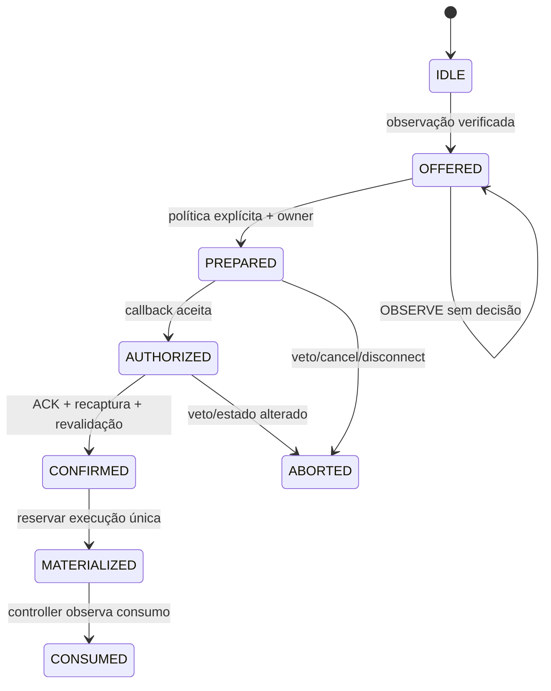

# Draft — selection-finalization-v1

Companion experimental independente: `ritual-duelists:selection-finalization-v1`, magic `0x48465331`, versão1. **Não altera a ABI1 mandatory-hand-selection-v1 nem seu companion lifecycle.** Não está nos pacotes canônicos, no guard ou no SDK público. Header em [selection_finalization_v1.h](../../experiments/hal9-handoff/selection_finalization_v1.h).

## Fronteira e responsabilidades

O owner RD conserva sua transação e o pending original até uma confirmação explícita anterior a qualquer troca de records ou consumo. O cliente de laboratório observa a proposta final dos callbacks TW/R reais. O companion não calcula score, não chama recover(), não escolhe uma política, não valida quotas em nome do Dual e não executa cartas. O fixture seleciona explicitamente KEEP_RD ou ALLOW_TW. OBSERVE não muda nada.

O protótipo suporta **uma carta na proposta final e na proposta anterior**. A transferência testada revoga um pending RD de set ritual680, ainda no deck, para executar TW da mão; a outra política mantém esse pending. Time Magic Support face-up está no escopo; banking face-down não foi autorizado pelo companion. Pending HOLD/ações combinadas e rituais que já começaram a consumir tributos não são autorizados por esta draft. Uma recusa não é licença para converter a ação em outra. Não há promessa de rollback ou de solução para materializadores externos não cooperativos.

```mermaid
sequenceDiagram
    participant RD as Planner/owner RD
    participant TW as Planners TW e R reais
    participant C as Cliente de laboratório
    participant HF as Companion experimental RD
    participant R as Produtor de regras R
    participant D as Gate Dual
    participant E as Materializador + controller
    RD->>RD: Pending legítimo e snapshot ABI1
    RD-->>TW: Retorno pela cadeia existente
    TW-->>C: Seleção final observada, sem injetar plano
    C->>HF: offer (somente leitura)
    HF-->>C: token + snapshot + cursor + pending físico
    C->>HF: prepare (política explícita do teste)
    HF->>R: evaluate real e revisão
    HF-->>C: ticket (nenhuma mutação do jogo)
    C->>HF: authorize(ticket)
    HF->>C: callback de autorização
    C->>HF: confirm(ticket)
    HF->>R: revalidar owner
    HF->>C: ACK explícito do cliente
    HF->>HF: verificar mundo/cursor/pending e recapturar seleção
    HF->>R: revalidar seleção recapturada
    HF->>HF: confirmar; revogar só pending correspondente se ALLOW_TW
    HF-->>C: resultado explícito
    C-->>D: controller continua pela cadeia existente
    D->>E: categoria nativa validada; RD pré-commit também preservado
    E->>E: uma materialização e coleta física
```

Na cadeia exercitada existe precommit R externo antes do gate Dual e outro precommit do owner RD dentro dele. KEEP_RD com pending: RD é materializador, sem chamar H depois de executar a troca. ALLOW_TW: o pending antigo foi revogado pelo seu owner; RD delega normalmente a H ativo ou ao motor. O fluxo não acrescenta `previous_swap` depois de materializar.

## Pacotes e ABI i386

Todos os pacotes têm abi/size estritos. O token de32 bytes vincula action, generation e connection do owner, revisão[3] do produtor, nonce do companion e connection epoch do cliente. Overflow recusa; nunca reaproveita nonce.

|Tipo|Bytes|Conteúdo/uso|
|---|---:|---|
|HfCursor|32|Modo/substate, slot, count, row/col e marcas de pilha|
|HfPending|32|Pending observado, fonte lógica, replacement, card, modo/destino, índice e token físico do deck|
|HfOffer|4316|Token, mandatory, seleção anterior, pending, snapshot4196 e cursor|
|HfProposal|4312|Token, política de laboratório, categoria definitiva, kind, destino, RhsPhysical e snapshot/cursor|
|HfTicket|56|Token exato, política explicitamente pedida, categoria/destino aprovados e count1|
|HfClient|20|ABI/size/epoch e callbacks authorize/confirm|
|HfStatus|60|Última fase, motivo, token, busy, conexão e consumo observado|
|HfFinalization|44|ABI/size/magic e oito operações|

Callbacks de cliente recebem **cópias locais verificadas** de ticket/proposta e não podem reter esses ponteiros após o retorno síncrono. ACK assíncrono e ponteiros persistidos não são suportados. Mudança de contexto do cliente exige desconexão/reconexão. Os callbacks alterações nos argumentos são recusadas e não atingem o armazenamento interno. `const` sozinho não é uma fronteira de imutabilidade em C. O controle pré-hardening confirmou o risco; não é uma falha nova dos objetos canônicos.

A janela nativa da mão não inicializa `AiActiveCard.deck_index` (`func_80027DF8` só o preenche no tail do deck). A identidade da mão vem de side.hand, record, ponteiro data e objeto. Não confundir `logical_index` da mão com um índice físico válido nem usar igualdade de ID como substituto. O payload ainda carrega a janela lógica como parte do snapshot para detectar alterações.

O RhsSnapshot é reutilizado **com seu layout congelado** como valor de observação; nenhum campo antigo muda de significado. As referências data/object são comparadas como endereços de32 bits do processo, juntamente com index/record/id/flags, snapshot do deck, estatísticas e janela lógica. Não são serializáveis nem válidas em outro processo. Cópias com mesmo ID não equivalem à mesma identidade.

`HF_NATIVE` exige categoria/destino consistentes com o tipo nativo. `HF_TIME_MAGIC` aceita somente ID16 físico e Support/M/T, além da cooperação do cliente. Isso não reinterpreta `rhs_selected` da ABI1 como permissão geral para híbridos. A categoria declarada não é uma nova regra do jogo: deve descrever a proposta efetiva, que o owner ainda verifica.

ABI1 antiga permanece: Rules12, Rendezvous24, Request4208, Response200 e Lifecycle28. A prova de compilação i386 e [ABI.json](ABI.json) verificam esses tamanhos. Esta draft exige ponteiros4 e execução síncrona na thread do duelo. Não é thread-safe para chamadas nativas concorrentes.

Futura evolução: novo key/version/tabela para mudanças incompatíveis. Não acrescentar campos à tabela1 esperando que clientes antigos aceitem; não aceitar size desconhecido por prefixo. Não promover esta draft à versão definitiva sem revisão.

## Operações e ponto de linearização

- `connect`: valida tabela/callbacks e copia os ponteiros. Um cliente já conectado deve manter a mesma tabela e seu código/contexto vivos. Não existem callbacks opcionais nulos nesta draft.
- `offer`: só quando RD está efetivo, com transação preparada e mundo compatível. Captura seleção final, cursor e pending exato sem modificá-los. Não aceita um pending de outro materializador como se fosse de RD.
- `prepare`: confere token, snapshot/cursor, origem física e política explícita. Reavalia R real/revisão. ALLOW_TW é recusado se a seleção antiga **ou** a avaliação atual forem mandatórias. KEEP_RD conserva a seleção mandatória anterior, incluindo seus bytes de posição, sem escolher outra Female por ID.
- `authorize`: callback do cliente precisa aceitar o ticket e a proposta. Reentrância, interrupção ou mudança de estado recusa.
- `confirm`: confere tudo de novo, exige ACK do cliente, escreve somente os bytes de seleção antes de consumo, recaptura e reavalia o produtor. Pending, cursor e mundo físico precisam continuar os mesmos. Após sucesso, atualiza a transação do próprio owner; ALLOW_TW revoga apenas o pending originalmente observado e ainda não executado. KEEP_RD o conserva. Este é o ponto de linearização.
- `cancel`: permitido antes da confirmação, sem restaurar cartas. Após confirmação/materialização/consumo retorna ALREADY_SPENT: não inventa rollback. Interrupção posterior exige recusa da ação ou nova recuperação coordenada, nunca ressuscitar pending antigo.
- `disconnect`: quando busy retorna BUSY; não autoriza liberar código/contexto. Somente o ACK positivo encerra o vínculo, limpa a cópia de callbacks e avança o epoch. Após esse ACK nenhuma tabela do cliente é lida. O teste protege a página com PROT_NONE para conferir essa fronteira.
- `read`: observação, nunca autorização para continuar uma ação. `state` registra a última fase alcançada, não uma licença de execução. Para UI/recuperação futura é obrigatório confrontar token/effective e o estado RHS lifecycle. Por exemplo, MATERIALIZED sem consumo seguido de QUARANTINE em RD deve ser apresentado como bloqueado; não como ação pronta para repetir.



HF_EXHAUSTED por nonce/epoch exige reinício; recover() do RHS não reinicia o allocator do companion. Callbacks não devem criar/destruir/mover cartas durante a negociação. ABA de instância com todos os bytes/endereços reutilizados permanece fora da qualificação e exige revisão/invalidação física cooperativa.

Fases/erro não substituem o RHS BLOCKED/QUARANTINE/EXHAUSTED. O materializador só passa com confirmação e token ainda válido. O monitor RD já existente continua conferindo cursor/pilha/identidades até a coleta. Não existe reparo após uma carta ter sido consumida. Se outro materializador contornar o owner ou um wrapper alterar dados depois da última validação, é necessária sua cooperação; esta draft não é um mecanismo de isolamento contra código nativo arbitrário.

## Limites de qualificação

Os planners RD/TW e produtor Queen são reais. O **cliente desta draft é o driver de teste**, que faz a negociação depois dos callbacks reais; não é um provider já implementado no núcleo TW. Catalogação, tabuleiro, relógio, renderer e partes do motor continuam fixtures. O código da ponte é executado no objeto RD recompilado, não somente num modelo auxiliar.

O Dual real participa dos testes positivos. Para TW Support seu gate anterior ao consumo ainda observa o tipo nativo Monster, como no PR33; o adapter corrige o papel contabilizado. Os testes de transferência começam com ambas as quotas livres. Portanto callback executado + ledger final correto **não prova** que a categoria definitiva Support seja entregue a todos os gates, nem qualifica um handoff TW Support durante bônus. A regressão bônus Support→Monster de duas cópias permanece separada e usa a candidata exata do PR33.

Antes de adoção: decidir a política não obrigatória, implementar/revisar um cliente cooperativo no adapter TW próprio, qualificar a categoria em todas as quotas/ordens necessárias e definir recuperação após invalidação de uma confirmação. Não liberar a composição pelo guard com base apenas nesta prova de viabilidade.
